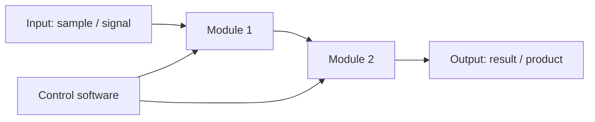

# Design Solution Definition: `<Subsystem / Module Name>`

> **Project:** `<Project name>`
> **Document ID:** `DSD-<NNN>-<SHORT-NAME>`
> **Version:** `0.1.0` · **Status:** `Draft | In Review | Approved | Superseded`
> **Project phase:** `<e.g. Concept / Proof of Concept / Prototype / Release>`
> **Last modified:** `YYYY-MM-DD`
> **Repository path:** `docs/design/<name>/README.md`

HOW TO USE THIS TEMPLATE
- Replace every `<placeholder>`. Delete guidance comments before review.
- One DSD per subsystem or module
- The DSD must stand alone: a reviewer should be able to judge the design
  from this document, the linked requirements, and the linked evidence.
- Normative language: "shall" = requirement, "should" = recommendation,
  "may" = optional.

---

## Document control

### Roles and sign-off

| Role | Name | Affiliation / Handle | Date | Signature / Review link |
|---|---|---|---|---|
| Author(s) | | | | |
| Reviewer (technical) | | | | |
| Concurrence (SE Reviewer) | | | | |
| Concurrence (Quality management reviewer) | | | | |
| Approval (Project Manager) | | | | |

> Note : Link approval to any relevant PR (Pull Request)
> Affiliation/Handle : Role/ Username on Github

### Modification log

| Version | Date | Author(s) | Main changes | PR / Commit |
|---|---|---|---|---|
| 1.0.0 | YYYY-MM-DD | | First version | |

---

## Table of contents

1. [Introduction](#1-introduction)
2. [Requirements and traceability](#2-requirements-and-traceability)
3. [Concept justification](#3-concept-justification)
4. [Traded-off concepts](#4-traded-off-concepts)
5. [Quality management and compliance](#5-quality-management-and-compliance) /!\ THIS SECTION IS NOT FINALISED /!\
6. [Licensing](#6-open-source-considerations) /!\ THIS SECTION IS NOT FINALISED /!\
7. [Open issues and future work](#7-open-issues-and-future-work)
8. [References](#8-references)
9. [Appendices](#9-appendices)

---

## 1. Introduction

### 1.1 Purpose and scope

<!-- Why does this document exist, at which review/milestone is it produced,
and what decision does it support? State what is IN and OUT of scope. 

DO NOT CHANGE ANYTHING IN THIS SECTION EXCEPT THE HIGHLIGHTED SECTIONS -->

This Design Solution Definition (DSD) is at a `<Concept / Proof of concept / Prototype / Public Release >` stage
validated on `<date>`. It justifies the concept selected for `<subsystem>`.

It covers:

- the problem the subsystem must solve
- the retained concept: architecture, components, and design choices
- the concepts that were considered and not retained
- risks, quality, and compliance implications.

**Out of scope:** `<list explicitly if you have another document that covers another part of the design. If nothing relevent put Not Applicable>`

### 1.2 Responsibility and change authority

<!-- Who owns this document? Who may approve changes? How are changes
proposed (issue, RFC, pull request)? -->

- **Document owner:** `<name / team>` <!-- Who is responsible to keep this document up to date ? --> 
- **Change authority:** `<role / committee>` <!-- What is the role/responsibility of the person -->

### 1.3 Abbreviated terms and definitions

| Term | Definition |
|---|---|
| `<TERM>` | `<Definition>` |

> EXAMPLE
>
>| Term | Definition |
>|---|---|
>| DSD | Design Solution Definition |
>| ICD | Interface Control Document | 
>

## 2. Requirements and traceability

<!-- Do not duplicate the full requirements document. Link to it and list only
the requirements this design directly addresses. -->

| Requirement ID | Verification method | Status |
|---|---|---|
|   |   |   |

> EXAMPLE
> | Requirement ID | Verification method | Status |
> |---|---|---|
>| REQ-001 | A | met |

> **Verification methods:** (D)emonstration, (T)est, (M)easurement, (I)nspection, (A)nalysis
 

---

## 3. Concept justification

`<Explain HOW the design addresses the technical problem it's trying to solve. Every major element should trace back to a need or requirement>`

The following chapters and sub-chapters are an example. Tailor them to be the most relevant to your own system.

### 3.1 Solution overview

`<Shortly, how does the retained concept address the problem ? State the core idea in one paragraph.>`

<!-- Mermaid renders natively on GitHub. Alternatively link an image from
`docs/figures/`. Include interfaces: data, mechanical, electrical,
biological/sample flow, and user interaction. -->

*Figure 3.1: High-level architecture of `<subsystem>`.*

### 3.2 Main design choices

<!-- One subsection per significant choice. Use this pattern:
Decision · Rationale · Requirements addressed · Consequences. -->

#### 3.2.1 `<Design choice name>`

- **Decision:** `<what was chosen>`
- **Rationale:** `<why, with evidence or references>`
- **Requirements addressed:** `REQ-xxx, REQ-yyy`
- **Consequences / limitations:** `<what this commits us to or rules out>`

#### 3.2.2 Operating modes

<!-- For instruments: operating modes. For protocols and pipelines: workflow
stages. Include entry and exit conditions and what is active in each. -->

| Mode / Stage | Purpose | Entry condition | Exit condition | Active components |
|---|---|---|---|---|
| Idle | | | | |
| Nominal operation | | | | |
| Calibration | | | | |
| Safe / fault state | | | | |

### 3.3 Functionally linked systems

State here which other (sub-)systems are necessary or planned to be
used with the sytem you're currently designing

### 3.4 Performance budgets and design margins

Mass/Power/Compute/Delay budgets. Either include them here directly or link the relevant excel sheet

---

## 4. Traded-off concepts

<!-- Show your work. This section protects the project from re-litigating
decisions and records why alternatives were rejected. -->

`<This is the most important part of this document. Please fill it in with great attention. >`

`<The goal of this section is to go over every other solution you found relevant but that you chose not to pursue.>`

### 4.1 Trade-off method

The trade-off method used was based on the following criteria : 
- `<criteria nmbr 1>`
- `<criteria nmbr 2>`
- ...

`<Describe criteria, weights, and scoring scale. This is a standardized way to explicit your priorities in the design.>`

 The table given below is an example. Adapt it with the above mentionned criterias

`<example for an ADC chip for a proof of concept board>`

| Criterion | Weight (1 - 5) | Rationale for weight |
|---|---|---|
| Meets performance requirements | 5 | This ADC was chosen to be part of a first proof of concept. As such, performance is the priority. |
| Safety and biosafety | 3 | ADC is not in direct contact with the patient. While a medical approved chip is favourable, it is not mandatory |
| Cost | 3 | This is a proof of concept. The ADC is ordered in small batch and as such prices are higher. Additionally, budget is a constraint for this board  |
| Reproducibility and accessibility | 4 | Proof of concept. By definition needs to work reliabily and predictably |
| Supply chain robustness  | 2 | This ADC has high performance requirements that cannot be fulfilled with common chips. |
| Maintainability and community support | 1 | This is not expected to be replaced, changed or maintained. |

Score scale : 
> [1] : Does not meet any requirements
> [2] : Meets some requirements 
> [3] : Meets all minimum requirements 'Shall' requirements
> [4] : Meets all minimum requirements and 'should'
> [5] : Meets all requirements, 'Shall, should & may'

### 4.2 Traded-off design choices

#### 4.2.1 `<Alternative design choice A>`

- **Description:**
- **Pros**:
- **Cons**:

#### 4.2.2 `<Alternative design choice A>` score

 

| Criterion | Weight (1-5) | score (1-5) |
|---|---|---|
| Meets performance requirements | 5 | 3 |
| Safety and biosafety | 3 | 5 |
| Cost | 3 | 1 |
| Reproducibility and accessibility | 4 | 4 |
| Supply chain robustness* | 2 | 2 |
| Maintainability and community support | 1 | 1 |
| ---|---|---|
|Total Score| 54 | max score : 90 | 

#### 4.2 `<Retained design choice>` score

- **Pros**:
- **Cons**:

| Criterion | Weight (1-5) | score (1-5) |
|---|---|---|
| Meets performance requirements | 5 | 4 |
| Safety and biosafety | 3 | 3 |
| Cost | 3 | 3 |
| Reproducibility and accessibility | 4 | 4 |
| Supply chain robustness* | 2 | 3 |
| Maintainability and community support | 1 | 2 |
| ---|---|---|
|Total Score| 62 | max score : 90 | 

### 4.3 Trade-off summary

| Option | Score | Retained | Key reason |
|---|---|---|---|
| Retained concept | 62 | Yes | Better performance, lower price |
| Alternative A | 54 | No | Too expensive, lower performance|

## 5. Quality management and compliance

**WORK IN PROGRESS**
<!--
<!-- Adapt to your regulatory context. If the project is RUO-only, say so and
explain which parts apply by choice (good practice) versus by obligation. 

### 5.1 Regulatory classification and pathway

| Item | Statement |
|---|---|
| Intended use classification | `<RUO / IVD / medical device / bioprocess / environmental / other>` |
| Target jurisdictions | `<EU / US / CH / UK / other>` |
| Applicable regulation | `<e.g. EU IVDR 2017/746, EU MDR 2017/745, FDA 21 CFR 820 (QMSR), 21 CFR Part 11>` |
| Device / product class | `<class and rationale>` |
| Regulatory strategy | `<summary, notified body / agency contact status>` |

### 5.2 Quality management system

- **QMS framework:** `<ISO 13485 / ISO 9001 / GLP / GMP / GCP / lightweight in-house QMS>`
- **QMS scope and document hierarchy:** `<link>`
- **Design controls followed:** `<design inputs → outputs → review → verification → validation → transfer → changes>`
- **This document's place in the design history file (DHF):** `<link>`

### 5.3 Applicable standards and guidelines

| Standard / Guideline | Title | Applicability | Compliance status |
|---|---|---|---|
| ISO 13485 | Medical devices: Quality management systems | | Planned / Partial / Compliant / N/A |
| ISO 14971 | Application of risk management to medical devices | | |
| IEC 62304 | Medical device software life cycle | | |
| IEC 61010-1 | Safety of electrical equipment for measurement, control, laboratory use | | |
| IEC 62366-1 | Usability engineering | | |
| ISO 20387 | Biobanking: general requirements | | |
| `<other>` | | | |

### 5.4 Ethics, access, and biosecurity compliance

| Topic | Applicability | Status / reference |
|---|---|---|
| Ethics committee / IRB approval | | |
| Informed consent | | |
| Nagoya Protocol / access and benefit sharing | | |
| Biosafety committee approval | | |
| Import / export / dual-use controls | | |
| Animal research regulations | | |

-->

## 6. Licensing

**WORK IN PROGRESS**

<!--
| Topic | Decision |
|---|---|
| Hardware license | `<CERN-OHL-S / CERN-OHL-W / TAPR / other>` |
| Software license | `<Apache-2.0 / GPL-3.0 / MIT / other>` |
| Documentation and data license | `<CC-BY-4.0 / CC0 / other>` |
| Open Source Hardware certification | `<OSHWA status>` |
| Licence compatibility of all dependencies | `<checked on YYYY-MM-DD, link to SBOM>` |
| Patents / IP / prior art | `<statement, defensive publication?>` |
| Contribution and governance model | `<link to CONTRIBUTING.md / GOVERNANCE.md>` |
| Liability and warranty disclaimer | `<statement, especially for any clinical use>` |
| Sourcing for builders | `<BOM with alternates, availability of parts worldwide>` |
| Quality of community-contributed changes | `<review gates, required tests, who can merge>` |

-->

## 7. Open issues and future work

| ID | Issue / TBD / TBC | Owner | Due | Impact if unresolved |
|---|---|---|---|---|
| OI-01 | | | | |

---

## 8. References

1. `<Applicable documents (binding): requirements spec, standards, regulations>`
2. `<Reference documents (informative): papers, datasheets, prior DSDs>`

---

## 9. Appendices

### Appendix A: Bill of materials

`<link to BOM file>`

<!-- FILL With relevant items>
